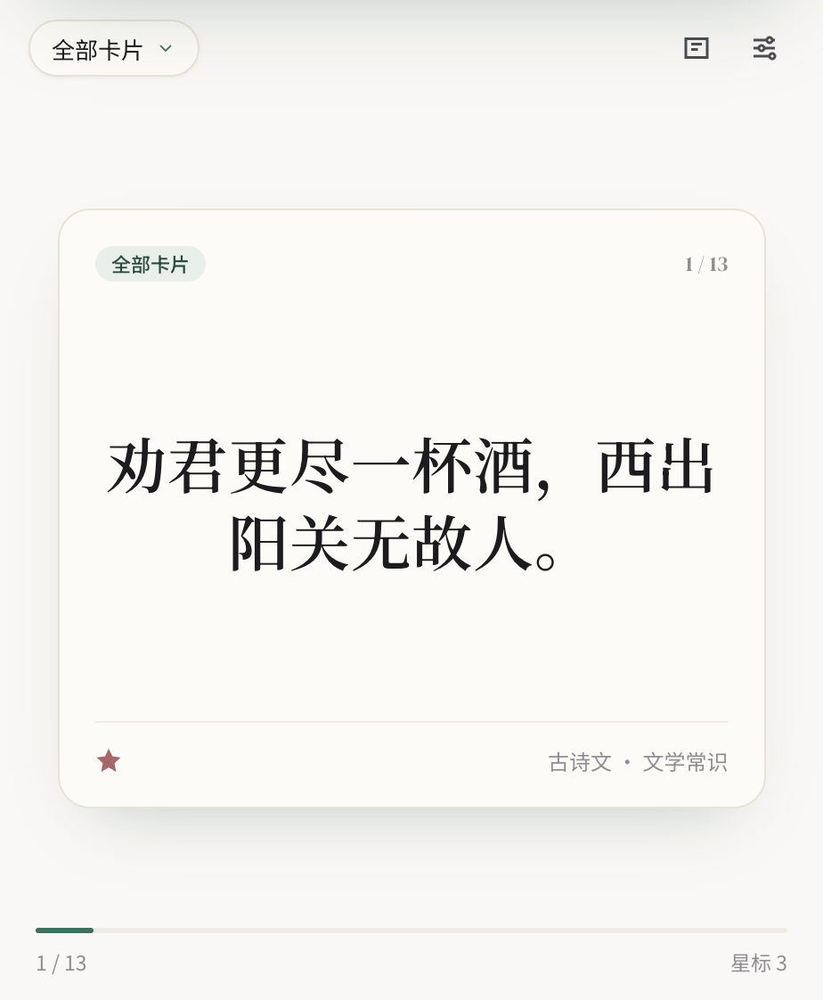
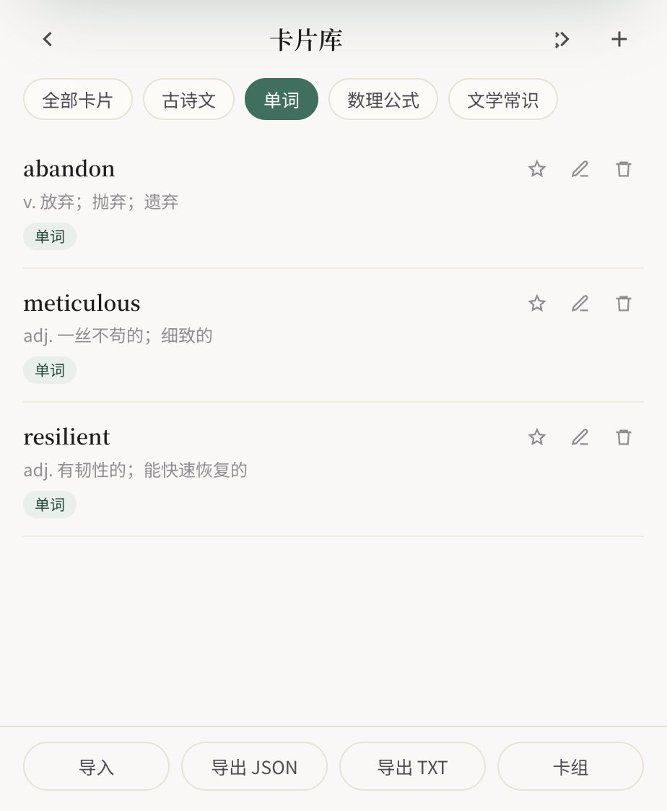
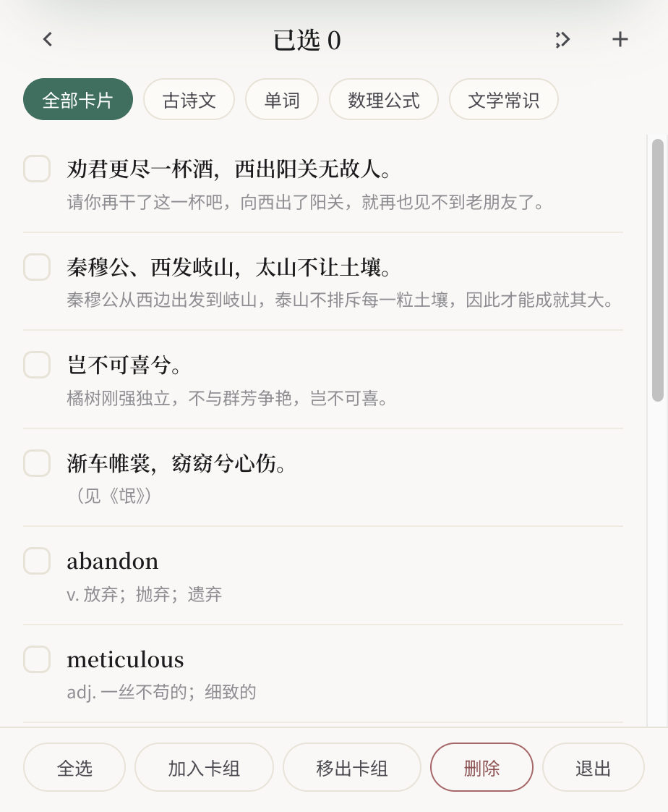

# 闪过 Flashcards

一个纯前端的闪卡速记应用。单文件、零依赖、零构建 —— 双击 `index.html` 就能用。

数据全部存在浏览器本地（localStorage），可选通过 WebDAV 在多设备间同步。





## 特性

**背诵**
- 点击卡片翻面看答案
- 左右滑动切卡，滑动跟手、带惯性
- **长内容卡片：正反面文字超出卡片时，卡内上下滑动就能看全**（短内容仍然垂直居中）
- 从**屏幕顶部 1/5** 处下拉，拉出搜索面板，按关键词搜卡片正反面，命中处高亮，点结果直接跳到那张卡
- 点卡片上的星标按钮可随时加/取消星标（**上滑不再加星标**）
- 键盘：`空格`/`Enter` 翻面 · `←`/`→` 切卡 · `S` 星标 · `D` 搜索
- 底部进度条显示当前进度与星标总数

**卡片库**
- 按卡组筛选卡片，卡组名横向滑动
- 新增 / 编辑 / 删除卡片，一卡可归属多个卡组
- 批量模式：多选后批量加入卡组、移出卡组、删除
- 导入 / 导出 JSON、导出 TXT（按卡组分节）

**设置**
- 主题：浅色 / 深色 / 跟随系统
- 字号：标准 / 大 / 特大
- WebDAV 同步：测试连接、一键同步（双向合并，按 `updatedAt` 决胜）
- 数据导入导出、清空全部数据（连示例卡片一起清掉）
- 卡片与卡组数量统计

## 快速开始

### 直接打开

```bash
open index.html          # macOS
xdg-open index.html      # Linux
```

用浏览器打开 `index.html` 即可。首次打开会载入 **3 张**示例卡片（古诗文 / 单词 / 数理公式各一张），看完样例后可在「设置 → 清空全部数据」一键清干净 —— 之后这个应用就是完全空白的，只装你自己的卡。

### 本地预览（推荐用于开发）

部分浏览器对 `file://` 的限制较多（WebDAV 请求、文件导入），建议起一个本地静态服务器：

```bash
python3 -m http.server 8777
# 打开 http://127.0.0.1:8777/index.html
```

### 装到手机 / 桌面

这是一个纯静态页面，把它放到任意静态托管（GitHub Pages、Vercel、Netlify，或自己的 Nginx）即可手机访问。也可以用「添加到主屏幕」当作 PWA 使用 —— 已配置 `viewport-fit=cover` 与 `env(safe-area-inset-*)` 安全区适配。

### 打包成 Android APK

`android/` 目录下有一套完整的 Android 宿主工程，把本应用打包成可安装的 APK。整个 App = 一个全屏 WebView + 打包进去的同一份 `index.html`，**不引入 Cordova / Capacitor，也不引入任何前端构建**。

```bash
cd android
echo "sdk.dir=$HOME/Library/Android/sdk" > local.properties   # 首次
export JAVA_HOME=$(/usr/libexec/java_home -v 17)

./gradlew assembleRelease        # 正规路径
./build-apk.sh                   # 离线路径：无需下载 Gradle，产物一致
```

产物：

| 变体 | 路径 | 包名 |
| --- | --- | --- |
| 正式包 | `android/app/build/outputs/apk/release/app-release.apk`（或 `android/build/manual/out/flashcards-release.apk`） | `com.amarisgo.flashcards` |
| 调试包 | `android/app/build/outputs/apk/debug/app-debug.apk`（或 `android/build/manual/out/flashcards-debug.apk`） | `com.amarisgo.flashcards.debug` |

调试包带 `.debug` 后缀，可以和正式包同时装在手机上对比。安装：

```bash
adb install -r app/build/outputs/apk/release/app-release.apk
# 或把 apk 传到手机上直接点开（需允许「安装未知来源应用」）
```

**APK 版额外解决的问题**（纯网页环境下行为完全不变）：

| 网页版的限制 | APK 里的处理 |
| --- | --- |
| `file://` 下 localStorage 支持不一致 | 用虚拟 https 源 `https://flashcards.local/` 加载页面，localStorage 稳定持久化 |
| WebDAV 跨域被 CORS 拦下 | `window.Android.davRequest` 走原生 HTTP，不受同源策略约束 |
| `HttpURLConnection` 不支持 `PROPFIND` | `SimpleHttp` 用 Socket 手写 HTTP/1.1，方法不受限 |
| `<a download>` 导出在 WebView 里无效 | `window.Android.saveFile` 写入系统「下载」目录（免权限） |
| 返回键直接退出应用 | 返回键先交给 `window.Flashcards.back()` 关闭弹窗 / 搜索面板 / 菜单 |
| 依赖 Google Fonts，离线字体发不出来 | 移除 CDN 引用，Latin 字体内置为 woff2，中日韩用系统 Noto CJK |

签名密钥在 `android/keystore/`，**不入库**，需自行生成（命令见 [android/README.md](android/README.md)）。
⚠️ 换签名密钥就无法覆盖安装，必须先卸载旧版 —— 而卸载会连同 localStorage 里的卡片数据一起删掉，请先在应用里导出 JSON 备份。

完整的构建说明、调试方式与常见问题见 [android/README.md](android/README.md)。

## 数据存放

| 位置 | 说明 |
| --- | --- |
| `localStorage["flashcards.v2"]` | 当前版本的全部数据（卡片、卡组、设置） |
| `localStorage["flashcards.v1"]` | 旧版数据，仅用于自动迁移，迁移后写回 v2 |
| `localStorage["flashcards.hint.v1"]` | 仅记录「首次显示操作提示」，不存业务数据 |

数据结构：

```jsonc
{
  "version": 2,
  "cards": [
    {
      "id": "a8c186c...",
      "front": "劝君更尽一杯酒，西出阳关无故人。",
      "back": "请你再干了这一杯吧……",
      "starred": true,
      "groups": ["g1", "g2"],      // 卡片所属卡组 id 数组，可为空
      "createdAt": 1730000000000,
      "updatedAt": 1730000000000
    }
  ],
  "groups": [
    { "id": "g1", "name": "古诗文", "updatedAt": 1730000000000 }
  ],
  "settings": {
    "theme": "light",             // light | dark | auto
    "fs": "std",                  // std | lg | xl
    "group": "all",               // 上次背诵的卡组
    "lastSync": 1730000000000,    // 上次 WebDAV 同步时间
    "webdav": { "url": "", "user": "", "pass": "", "dir": "flashcards" }
  }
}
```

⚠️ 数据只存在浏览器里。**清理浏览器数据、换浏览器、换设备都会丢失**，请用「导出 JSON」定期备份。

## WebDAV 同步

在「设置 → WebDAV」填入地址、账号、密码与目录，然后：

- **测试连接**：先 `OPTIONS`，失败则退回 `PROPFIND`，再检查目标目录是否存在
- **立即同步**：先 `GET` 远端文件与本地合并，再 `PUT` 回远端；目录不存在会先自动创建

合并规则是**按 `updatedAt` 时间戳逐条决胜**，卡片和卡组各自独立比较，因此多设备同时编辑不会互相覆盖整份数据（但同一条记录的同时修改仍会丢一方）。

同步文件路径为 `<地址>/<目录>/flashcards.json`。密码以明文存在 localStorage，请自行评估设备安全性。

设置页会实时显示**备份位置**的完整 URL —— 同步完去网盘里按这个路径找文件，不用猜。

### ⚠️ 坚果云：只能用 APK，网页版会被浏览器拦下

| | 网页版 | APK |
| --- | --- | --- |
| 坚果云 | ❌ **不行** | ✅ 可以 |
| 自建 / 支持 CORS 的 WebDAV | ✅ | ✅ |

原因：坚果云**不返回 `Access-Control-Allow-Origin` 头**，浏览器会以同源策略拦下跨域的 WebDAV 请求。这是浏览器强制的，网页端绕不过去。APK 走的是原生 HTTP 通道（`window.Android.davRequest`），不受同源策略约束。

坚果云配置：

| 字段 | 填什么 |
| --- | --- |
| 地址 | `https://dav.jianguoyun.com/dav/` |
| 账号 | 你的坚果云**邮箱** |
| 密码 | 「安全选项 → 第三方应用管理 → 添加应用密码」生成的**应用密码** |
| 目录 | 随便起，如 `flashcards`（不存在会自动建） |

> 密码必须是**应用密码**，不是网页登录密码 —— 坚果云不允许第三方应用用登录密码访问 WebDAV。
> 另外坚果云的 WebDAV 只能看到「同步文件夹」，文件可能出现在某个同步文件夹里而不是「我的坚果云」根目录。

**同步失败时现在会直接告诉你原因**，不再是一句笼统的「上传失败」：

| 提示 | 原因 |
| --- | --- |
| `认证失败：账号或应用密码不对` | 账号填错，或用了登录密码而不是应用密码 |
| `没有权限：应用密码可能没勾选「读写」权限` | 生成应用密码时没勾读写权限 |
| `父目录不存在` | 目录建不出来，检查目录名，或去网盘手动建好 |
| `读取失败 · …` | 远端文件读不到，多半是认证问题 |

> 以前上传时**不检查服务器返回码**，服务器回 401/403/409 也会显示「已同步」——
> 于是你以为存上了，其实网盘里什么都没有。这是本次修掉的主要问题。

## 项目结构

```
Flashcards/
├── index.html      # 全部代码：HTML 结构 + CSS + JS（约 1478 行）
├── README.md       # 本文件
├── HANDOVER.md     # 项目接手文档：架构、数据流、扩展指引、遗留问题
├── .gitignore      # 忽略 .DS_Store 等
├── docs/images/    # README 配图
├── tools/          # 开发用的小工具（WebDAV 测试服务器与验证页）
└── android/        # Android 宿主工程：WebView 外壳 + 打包脚本
```

整个应用就是 `index.html` 一个文件，内部按注释分块：

| 分块 | 行号 | 内容 |
| --- | --- | --- |
| storage | 475 | localStorage 读写、键名常量 |
| seed / migrate | 491 | 3 张示例卡片、v1 → v2 数据迁移 |
| data helpers | 538 | `cardsOf` / `groupById` 等查询helper |
| theme | 562 | 主题与字号应用 |
| study view | 577 | 背诵视图渲染、翻面、切卡、星标 |
| group menu | 669 | 卡组下拉菜单（含「星标」入口、「清空星标」） |
| search sheet | 702 | 下拉搜索面板：匹配、高亮、跳转到卡片 |
| gestures | 754 | 指针手势：滑动切卡 / 卡内滚动避让 / 顶部 1/5 下拉搜索（见 HANDOVER §12） |
| library | 874 | 卡片库列表与批量栏渲染 |
| modal | 922 | 通用弹窗框架 |
| card editor | 957 | 新增 / 编辑卡片 |
| group manager | 1000 | 卡组增删改 |
| batch group ops | 1053 | 批量加入 / 移出卡组 |
| import / export | 1078 | JSON / TXT 导入导出、数据合并 |
| webdav | 1147 | WebDAV 连接测试与同步（建目录、检查返回码、错误提示） |
| views | 1297 | 视图切换、`closeTopOverlay` 浮层关闭 |
| events | 1323 | 事件绑定与键盘快捷键 |
| init | 1458 | 启动引导 |

## 开发约定

- **无构建、无依赖**：不引入 npm 包、不引入框架。要加能力就写原生 JS。
- **状态集中**：全局 `store`（数据）与 `ui`（界面状态）。任何写操作后都要 `save()` 落盘，再调 `renderLib()` / `renderStudy()` 重绘。
- **渲染方式**：整块 `innerHTML` 重绘 + 事件委托（`data-*` 属性 + `closest()` 匹配）。不要在渲染出来的 DOM 上挂监听器。
- **提交信息**：中文 Conventional Commits，如 `fix(library): 修复批量操作底栏溢出`、`feat(study): 增加卡片间隔提示`。
- **改完必须验证**：至少跑一遍「背诵 → 卡片库 → 批量模式 → 设置」四个视图。

## 对外接口

页面在 `window` 上暴露了两个对象，方便调试或被宿主 App（Android WebView）调用：

```js
window.__fc       // { store, ui, render, renderLib, show }  调试用
window.Flashcards // { view(): string, home(): void, back(): boolean }
```

`Flashcards.back()` 会关闭最上层的浮层（弹窗 → 搜索面板 → 卡组菜单），没有浮层可关时返回 `false` —— Android 宿主据此决定是「关浮层」还是「退出应用」。

`window.Android` 若存在会被自动使用：

| 方法 | 用途 | 降级行为 |
| --- | --- | --- |
| `Android.setStatusBar(color, lightIcons)` | 同步状态栏配色 | 无宿主时跳过 |
| `Android.saveFile(name, content, type)` | 导出文件写进系统「下载」目录 | 回退到 `Blob` + `<a download>` |
| `Android.davRequest(method, url, headers, body)` | 原生 HTTP 通道，绕过 WebDAV 的 CORS 限制 | 回退到 `fetch` |

后两个能力都通过 `davFetch()` 这层薄封装接入：**纯网页环境下 `window.Android` 为 undefined，行为与以前完全一致。**

## 近期更新（v2.3）

| 改动 | 之前 | 现在 |
| --- | --- | --- |
| 长内容卡片 | ❌ 超出卡片高度的部分被裁掉，看不到 | ✅ **卡片内部可滚动**，正反面都能滑到最后一个字；短内容仍居中 |
| 上滑星标 | ⬆️ 在卡片上向上划会加星标 | ⬜ **手势已取消**，上滑不再有任何动作 |
| 下拉搜索触发范围 | ⬇️ 任意位置下拉都会弹出搜索面板 | ✅ 只从**屏幕顶部 1/5** 处下拉才触发，卡片中部下滑不再误触 |

星标功能本身**不受影响**：卡片上的星标按钮、卡组菜单里的「星标」入口、菜单底部的「清空星标」都保留，
键盘 `S` 也照常加星标。

实现细节、踩过的坑与验收清单见 [HANDOVER §12](HANDOVER.md)。

## 已知问题

- 批量操作栏在极窄屏（< 340px）下按钮文字会被省略号截断，功能不受影响。
- WebDAV 密码明文存储于 localStorage。
- 无自动化测试，回归验证依赖手动走查。
- 长内容滚动与新手势只在无头 Chrome 里做过自动化验收，iOS / Android 真机手感仍建议装机复检。
- APK 版尚未在真机上完整跑过一遍（构建机无设备可测），但 Gradle 与离线脚本两条构建路径均已验证可用。详见 [android/README.md](android/README.md) 与 HANDOVER 的技术债清单。

更多细节见 [HANDOVER.md](HANDOVER.md)。
